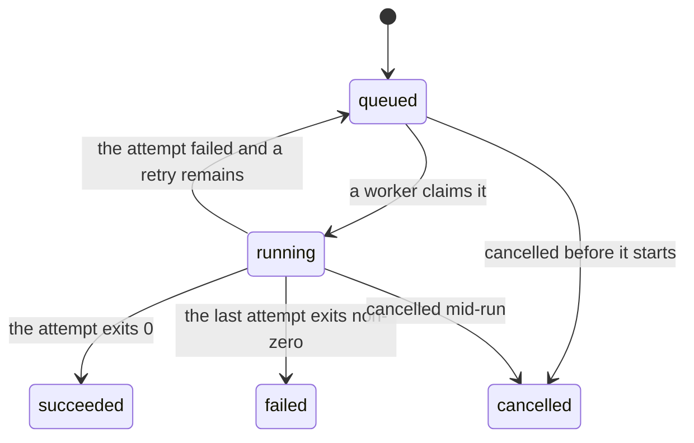

# Job outcomes and retries

## States

A job is `queued` when created, `running` from the moment a worker claims it, and ends
in `succeeded`, `failed`, or `cancelled`.

A job cancelled while running keeps whatever output its attempt had already written.
The product does not roll it back.

## Attempts and retries

A failed attempt is retried up to three times, at one, five, and twenty-five minutes
after the failure. The job stays `queued` between attempts, so a job waiting on a
retry is indistinguishable from a job waiting on a free worker.

A job that exhausts its retries receives no further automatic attempts. It ends
`failed`, carrying the last attempt's exit status and the tail of its output. See
[which output survives pruning](./jobs.md#output-and-pruning) to retrieve an attempt's output later.

The dashboard shows this limit as **Retries remaining**. For counting the initial
attempt separately, see the [attempt budget](./attempts.md#attempt-budget).
